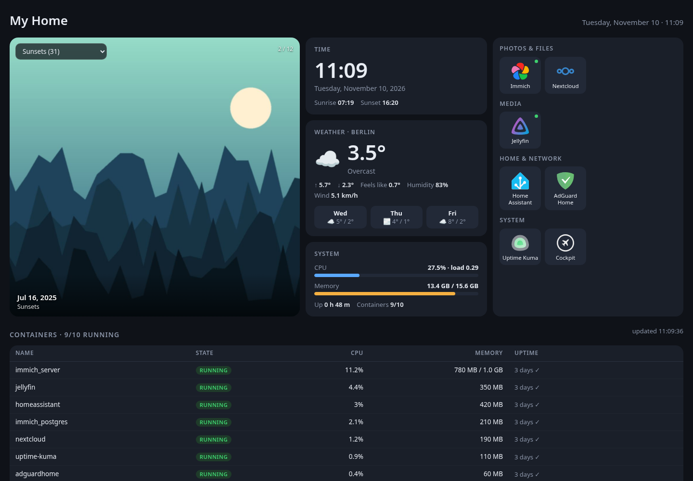

# pi-home-dash

A tiny, fast home dashboard for your Raspberry Pi (or any Docker host).
One page with your self-hosted apps, a big photo carousel from **Immich**, the time, the weather, host stats and a live Docker container table.



*Screenshot uses generated demo images and fake container data.*

- **Small:** one Python file (stdlib + PyYAML) and one HTML file. No build step, no database, no Node. It uses about 20 MB of RAM and runs with a 64 MB limit.
- **Locked down by default:** read-only container, all capabilities dropped, non-root user, listens on `127.0.0.1` unless you choose otherwise.
- **Config is one YAML file.** Edits show up on the next page refresh, with no restart.

## Features

| | |
|---|---|
| **App tiles** | Grouped tiles with local icons. An optional server-side `ping` URL per tile shows a green or red dot. |
| **Photo carousel** | Random photos from your whole Immich library or from one album, picked from a selector on the page (each browser remembers its choice). The photo changes every `slide_seconds` with a crossfade. It has prev/next buttons, pauses on hover, and opens the photo in Immich on click. A fresh random set loads after every cycle. |
| **Private by design** | The Immich API key never reaches the browser. Images are proxied as `/thumb/<id>`, and only for asset IDs the server handed out itself. |
| **Clock & weather** | Browser-local clock (or a fixed `ui.timezone`), sunrise and sunset, and current weather plus a 3-day forecast from [Open-Meteo](https://open-meteo.com) (no API key; cached on the server). |
| **Host stats** | CPU, temperature, memory, load and uptime. |
| **Containers** | State, CPU % and memory for every container, refreshed live every `docker.refresh_seconds` (default 10 s; one shared server-side sample per interval, paused while the tab is hidden), through a read-only Docker API proxy (recommended) or the Docker socket. |
| **Languages** | English (default) and Greek (`ui.locale: el`). Adding a language means adding one block of strings in `static/index.html`. |

Every block is optional. Leave out `IMMICH_URL`, the `weather:` section or the Docker overlay and that part of the page disappears.

## Quick start

```bash
git clone https://github.com/<you>/pi-home-dash.git && cd pi-home-dash
cp .env.example .env                              # where to listen, Immich URL + key
mkdir -p config && cp config.example.yaml config/config.yaml   # your tiles, weather location, ...
./fetch-icons.sh immich jellyfin home-assistant   # icons are stored locally in config/icons
docker compose up -d --build
```

Then open `http://<DASH_BIND>:<DASH_PORT>` (default `http://127.0.0.1:3090`).

### Where it listens

The dashboard has **no login**. Keep it on your LAN or VPN:

```bash
# .env
DASH_BIND=127.0.0.1     # default: this machine only (use a reverse proxy in front)
# DASH_BIND=192.168.x.y # your LAN address
# DASH_BIND=100.x.y.z   # your Tailscale address
# DASH_BIND=0.0.0.0     # every interface (trusted networks only)
DASH_PORT=3090
```

To listen on several addresses, add more `ports:` lines in a `docker-compose.override.yml`.
**Do not port-forward it to the internet.**

### Immich

1. In Immich, go to **Account settings → API keys → New API key** and grant only:
   `asset.read`, `asset.view`, `album.read`.
2. Put it in `.env`:
   ```bash
   IMMICH_URL=http://host.docker.internal:2283   # how the container reaches Immich
   IMMICH_PUBLIC_URL=https://photos.example.com   # optional: lets a click open the photo in Immich
   IMMICH_API_KEY=...
   ```
3. Restart with `docker compose up -d`.

Set `immich.album` in `config.yaml` to an album name (or id) to choose the default. Leave it empty for random photos.

### Container stats (optional)

Choose one overlay with `COMPOSE_FILE` in `.env`:

| Overlay | How | Safety |
|---|---|---|
| `compose.docker-proxy.yml` **(recommended)** | Adds [tecnativa/docker-socket-proxy](https://github.com/Tecnativa/docker-socket-proxy) on an internal network with `CONTAINERS=1, POST=0` | Only GET on `/containers/*`. Everything else is refused. |
| `compose.docker-socket.yml` | Mounts `/var/run/docker.sock:ro` and sets `DOCKER_GID` | ⚠️ `:ro` does **not** make the Docker API read-only. Socket access is root-equivalent. pi-home-dash only sends GET requests, but that is a promise, not a barrier. |

```bash
# .env
COMPOSE_FILE=docker-compose.yml:compose.docker-proxy.yml
```

You can also point the app at an existing proxy with `DOCKER_HOST=tcp://host:2375`.

## Configuration

See [`config.example.yaml`](config.example.yaml) for every option. The main ones:

```yaml
title: My Home
ui:       {locale: en, clock_24h: true, timezone: Europe/Berlin, host_label: Raspberry Pi}
groups:   [{name: Media, tiles: [{name: Jellyfin, url: "http://jellyfin.local", icon: jellyfin, ping: "http://host.docker.internal:8096"}]}]
immich:   {album: "", count: 12, slide_seconds: 8, refresh_minutes: 10}
weather:  {name: Berlin, lat: 52.52, lon: 13.405, timezone: auto, units: metric}
docker:   {enabled: true, refresh_seconds: 10}
```

### Environment variables

| Variable | Default | Meaning |
|---|---|---|
| `DASH_BIND` / `DASH_PORT` | `127.0.0.1` / `3090` | Host address and port (compose) |
| `DASH_CONFIG_DIR` | `./config` | Folder with `config.yaml` and `icons/` (compose) |
| `DASH_CONTAINER_NAME` | `pi-home-dash` | Container name (compose) |
| `IMMICH_URL` | *(empty = no photos)* | Immich base URL as seen from the container |
| `IMMICH_PUBLIC_URL` | *(empty)* | Immich URL for your browser (click-through) |
| `IMMICH_API_KEY` | *(empty)* | Least-privilege key (see above) |
| `DOCKER_HOST` | *(empty)* | `tcp://proxy:2375` or `unix:///path/docker.sock` |
| `DASH_CONFIG` | `/config/config.yaml` | Config path inside the container |

## API

All GET, JSON unless noted: `/api/config`, `/api/status` (tile pings, cached 60 s), `/api/albums`, `/api/photos?album=<id>|all[&new=1]`, `/api/weather`, `/api/system`, `/thumb/<asset-id>?size=preview` (image), `/icons/<file>`, `/healthz`.

## Running without Docker

```bash
pip install pyyaml
DASH_CONFIG=./config/config.yaml DASH_LISTEN=127.0.0.1 IMMICH_URL=... IMMICH_API_KEY=... python3 app.py
```

## Security notes

- There is no authentication. Bind to LAN/VPN addresses or put it behind a reverse proxy that adds auth.
- The Immich key stays on the server. The thumbnail proxy only serves assets it has just listed.
- Tile `ping` URLs are requested by the server, so only put URLs you trust in `config.yaml`.

## License

[MIT](LICENSE)
